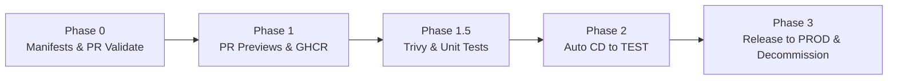

> This file lives in `DerekRoberts/dotfiles` at `config/skills/quickstart-from-argocd/`. `scripts/setup/ai.sh` copies every directory under `config/skills/` into `~/.agents/skills/`.

# QuickStart from ArgoCD (Legacy OpenShift Modernization)

Migrate a legacy OpenShift application—historically wired with in-cluster `BuildConfig` image builds, `bcgov-c/tenant-gitops-*` ArgoCD values repositories, manual `oc tag` namespace promotions, bespoke multi-workflow CI, and Artifactory remote proxies—to the unified `bcgov/quickstart-openshift` workflow suite powered by `bcgov/actions` and `bcgov/actions-openshift`.

---

## Use When
- An application uses the legacy 2019–2022 OpenShift deployment model:
  - In-cluster `BuildConfig` objects building container images inside `-tools`.
  - External GitOps repositories (`bcgov-c/tenant-gitops-<namespace>`) running ArgoCD.
  - CI workflows that run `yq` to commit image tags into tenant-gitops repos or run `oc tag` across namespaces.
  - Manual deployment workflows with GitHub issue approval actions (e.g. `trstringer/manual-approval`).
  - Deprecated `DeploymentConfig` manifests or legacy BCDK templates.
  - Base container images pulled through `artifacts.developer.gov.bc.ca/docker-remote/`.
- The user requests modernizing an app's CI/CD pipeline, adopting `quickstart-openshift`, or retiring ArgoCD tenant-gitops.

## Don't Use When
- The repository is already standardized on `bcgov/quickstart-openshift`.
- Non-OpenShift platforms (e.g. AWS ECS, Azure Container Apps).

---

## Core Architectural Principles

1. **Zero-Rebuild Continuous Delivery**:
   - Container images are built **once** on GitHub Actions runners during the PR stage and pushed to GHCR, tagged by PR number (`pr-<num>`).
   - Ephemeral preview environments deploy the image to `-dev`.
   - On squash-merge to `main`, `merge.yml` deploys the verified PR image to `-test` with **zero rebuilding**.
   - On published GitHub Release, `release.yml` promotes that exact tested image to `-prod` with **zero rebuilding**.
2. **In-Repo OpenShift Templates**:
   - Deployment configuration is stored directly in the application repository under `openshift/*.deploy.yml`.
   - OpenShift `Template` objects declare standard Kubernetes resources (`Deployment`, `Service`, `Route`, `ConfigMap`). Deprecated `DeploymentConfig` objects are eliminated.
3. **Canonical Docker Hub Registries**:
   - Base images pull directly from Docker Hub (`python:3.13-slim`, `node:20-bookworm-slim`, `nginx:1.29`). Internal Artifactory remote caching proxies (`artifacts.developer.gov.bc.ca/docker-remote/`) are eradicated.
4. **Clean Secrets Boundary**:
   - Scoped GitHub Environment variables and secrets (`test`, `prod`) replace legacy repository-wide OpenShift admin tokens.

---

## Hard Stops & Operational Guardrails

- **NEVER run `oc` or `kubectl` on the host**: All cluster mutations (cloning secrets, creating service accounts, updating role bindings) are performed by the human maintainer. Provide exact, click-by-click or command-line instructions.
- **NEVER touch database mutability or recreation settings**: Treat `overwrite: false` and database templates as immutable safety guardrails. Never alter volume reclaim policies, storage classes, or stateful manifests during workflow migrations.
- **NEVER deploy to PROD without explicit maintainer approval**: Phase 3 sets up the automation; actual release publication is an intentional maintainer action.
- **STRICT SCHEMAS**: No defensive fallback cascades (`A || B || C` or `|| ''`). Canonical inputs only.
- **Follow Project Standards**: All workflows must pin actions to 40-character commit SHAs with trailing version tags, use explicit LTS runner environments (e.g. `ubuntu-24.04` or `ubuntu-slim`), enforce minimum permissions (`permissions: {}`), and report through standard gate job names (`Validate Results`, `Analysis Results`, `PR Results`, `Merge Results`, `Release Results`).

---

## The 5-Phase Migration Playbook

Execute the migration sequentially across distinct, small PRs. Do not bundle phases.



---

### Phase 0: Inventory, Secret Discovery & Manifest Modernization

**Objective**: Model the application in standard OpenShift templates and establish CI validation before altering deployment behavior.

1. **Inventory Live Cluster State**:
   - Ask the maintainer to list cluster secrets in `-dev` and `-test`:
     ```bash
     oc get secrets -n <plate>-dev
     oc get secrets -n <plate>-test
     ```
   - Identify database secrets (e.g., Crunchy PostgreSQL `pguser` secret: `<app>-<env>-crunchy-pguser-postgres`), MinIO/S3 credentials, Keycloak secrets, and custom application secrets.
   - Identify existing routes, exposed ports, and environment variable requirements across all components.

2. **Author OpenShift Templates (`openshift/*.deploy.yml`)**:
   - Create one template per component (e.g., `backend.deploy.yml`, `frontend.deploy.yml`, `task-queue.deploy.yml`).
   - Use `apiVersion: template.openshift.io/v1`, `kind: Template`.
   - Declare standard parameters:
     - `NAME` (application module name, e.g. `myapp`)
     - `COMPONENT` (component name, e.g. `backend`)
     - `ZONE` (deployment zone: `pr-123`, `dev`, `test`, `prod`)
     - `IMAGE_TAG` (image tag or digest)
     - `REGISTRY` (default: `ghcr.io`)
     - `ORG_NAME` (default: `bcgov`)
     - `DOMAIN` (default: `apps.silver.devops.gov.bc.ca`)
     - Environment-specific flags: `ENABLE_KEYCLOAK`, `CRUNCHY_SECRET_NAME`, `MINIO_BUCKET_NAME`, `KEYCLOAK_URL`.
   - Declare modern Kubernetes `Deployment` resources:
     - Rolling update strategy: `maxUnavailable: 1`, `maxSurge: 1`.
     - Container image: `${REGISTRY}/${ORG_NAME}/${NAME}/${COMPONENT}:${IMAGE_TAG}`.
     - Liveness, readiness, and startup probes pointing to application health endpoints.
     - Secret references parameterized by `${CRUNCHY_SECRET_NAME}` or standard secret names.

3. **Configure GitHub Repository & Environments**:
   - Instruct the maintainer to set:
     - Repository variables: `OC_SERVER` (`https://api.silver.devops.gov.bc.ca:6443`), `OC_NAMESPACE` (`<plate>-dev`).
     - Repository secret: `OC_TOKEN` (service account token for `-dev`).
     - GitHub Environment `test`: variable `OC_NAMESPACE=<plate>-test`, secret `OC_TOKEN` (service account token for `-test`).
     - GitHub Environment `prod`: variable `OC_NAMESPACE=<plate>-prod`, secret `OC_TOKEN` (service account token for `-prod`).

4. **Add Workflow Validation (`.github/workflows/pr-validate.yml`)**:
   - Lint PR titles (Conventional Commits) and all GitHub Actions workflows via `bcgov/actions/pr-validate`.
   - Gate check: `Validate Results` (`bcgov/actions/workflow-results`).

---

### Phase 1: PR Previews & Cloud Container Builds

**Objective**: Move container compilation from OpenShift `-tools` to GitHub runners and enable isolated ephemeral preview environments.

1. **Ephemeral PR Preview Deployment (`.github/workflows/pr-open.yml`)**:
   - Trigger on `pull_request` (`types: [opened, reopened, synchronize]`).
   - Concurrency: `group: ${{ github.workflow }}-${{ github.event.number }}`, `cancel-in-progress: true`.
   - Job `builds`:
     - Matrix strategy over all deployable packages (`backend`, `frontend`, etc.).
     - Use `bcgov/actions/builder` with context, Dockerfile path, and diff triggers.
     - Tag images with `${{ github.event.number }}` and `${{ github.event.pull_request.head.sha }}`.
     - Publish to `ghcr.io/bcgov/<repo>/<package>`.
   - Job `deploys`:
     - Run `bcgov/actions-openshift/deployer` with `oc_namespace: ${{ vars.OC_NAMESPACE }}` (points to `-dev`).
     - Pass `ZONE="pr-${{ github.event.number }}"` and `IMAGE_TAG="${{ github.event.pull_request.head.sha }}"`.
   - Job `tests` (Post-Deploy Health Check):
     - Poll `https://${NAME}-pr-${{ github.event.number }}.${DOMAIN}/api/healthcheck` until HTTP 200 OK before marking the PR green.
   - Job `comment`: Post ephemeral deployment links on the PR.
   - Gate: `PR Results` (`bcgov/actions/workflow-results`).

2. **Ephemeral PR Cleanup (`.github/workflows/pr-close.yml`)**:
   - Trigger on `pull_request` (`types: [closed]`).
   - Run `bcgov/actions-openshift/cleaner` with parameters `-l app=${NAME}-pr-${{ github.event.number }}` to purge routes, services, deployments, and configmaps from `-dev`.
   - Gate: `Cleanup Results`.

---

### Phase 1.5: Security Analysis & Test Suite Resurrection

**Objective**: Reinstate continuous vulnerability scanning and resurrect unit test suites that bitrotted while CI was neglected.

1. **Security & Test Workflow (`.github/workflows/analysis.yml`)**:
   - Trigger on `push: branches: [main]`, `pull_request:`, and `workflow_dispatch:`.
   - Job `trivy`:
     - Run `aquasecurity/trivy-action` in filesystem (`fs`) mode scanning for `vuln,secret,misconfig`.
     - Cache `.trivycache` keyed by workflow file hash.
     - Set `skip-dirs` for directories that trigger upstream rate limits or irrelevant files.
     - Set `ref: ${{ github.event.pull_request.head.sha }}` on `actions/checkout` (no `|| ''`).
     - Upload SARIF to GitHub Code Scanning: on PRs, target `ref: refs/pull/${{ github.event.pull_request.number }}/head` and `sha: ${{ github.event.pull_request.head.sha }}`; on push, use default ambient ref.
   - Job `backend-tests` / `frontend-tests`:
     - Use `bcgov/actions/test-and-analyse` or native test runners.
     - Configure service containers (e.g. `postgres:15`) when application migrations use database-specific DDL syntax.
   - Gate: `Analysis Results` (`bcgov/actions/workflow-results`).

2. **Fix Bitrotted Tests**:
   - Run unit tests locally inside Podman (`podman run`) or via CI.
   - Fix latent schema drifts, uncaught exceptions (e.g. `decimal.InvalidOperation`), and missing default parameters in legacy service layers. Never skip or delete failing tests to make CI pass.

---

### Phase 2: Automated Continuous Delivery to TEST

**Objective**: Automate promotion to TEST on merge to `main` with zero image rebuilding.

1. **Merge Workflow (`.github/workflows/merge.yml`)**:
   - Trigger on `push: branches: [main]` (with `paths-ignore` for markdown).
   - Concurrency: `group: ${{ github.workflow }}`, `cancel-in-progress: false`.
   - Job `init`:
     - Use `bcgov/action-get-pr` to resolve the squash-merge commit to its source PR number.
   - Job `deploys`:
     - Set `environment: test`.
     - Run `bcgov/actions-openshift/deployer` targeting `vars.OC_NAMESPACE` (`<plate>-test`) using `secrets.OC_TOKEN`.
     - Pass `ZONE="test"` and `IMAGE_TAG="${{ needs.init.outputs.pr }}"`.
     - Pass test-specific parameters (e.g. `CRUNCHY_SECRET_NAME="<app>-test-crunchy-pguser-postgres"`, `MINIO_BUCKET_NAME="<test-bucket>"`).
   - Gate: `Merge Results` (`bcgov/actions/workflow-results`).

2. **Conduct End-to-End UAT in TEST**:
   - Verify deployment rollout and test database connectivity in `-test`.

---

### Phase 3: Production Release-to-Prod & Legacy Decommission

**Objective**: Establish tag-based Production deployment and eradicate all legacy build artifacts.

1. **Release-to-Prod Workflow (`.github/workflows/release.yml`)**:
   - Trigger strictly on published GitHub Releases (`on: release: types: [published]`).
   - Concurrency: `group: Merge`, `cancel-in-progress: false` (locks against `merge.yml`).
   - Job `init`:
     - Use `bcgov/action-get-pr` to map the release commit on `main` to its source PR.
     - Run `docker buildx imagetools inspect ghcr.io/${REPO}/${package}:${PR}` to verify that immutable image manifests exist in GHCR for all components before touching OpenShift.
   - Job `deploys`:
     - Set `environment: prod`.
     - Run `bcgov/actions-openshift/deployer` targeting `vars.OC_NAMESPACE` (`<plate>-prod`) using `secrets.OC_TOKEN`.
     - Pass `ZONE="prod"`, `IMAGE_TAG="${{ needs.init.outputs.pr }}"`, and prod-specific secret/bucket parameters.
   - Job `promote`:
     - Re-tag GHCR images with `prod` via `shrink/actions-docker-registry-tag`.
   - Gate: `Release Results` (`bcgov/actions/workflow-results`) with failure notification via `bcgov/actions/workflow-notifier`.

2. **Decommission Legacy Artifacts**:
   - Delete obsolete workflows: `prod-ci.yaml`, `replace-DC.yaml`, `push-*-to-artifactory.yaml`, `dev-ci.yaml`, `test-ci.yaml`.
   - Delete obsolete OpenShift BuildConfig manifests: `openshift/templates/*-bc*.yaml`, `oc-client` templates, etc.
   - Replace Artifactory proxy base images (`artifacts.developer.gov.bc.ca/docker-remote/*`) with official Docker Hub images (`python:*`, `node:*`, `nginx:*`, `eclipse-temurin:*`) across all Dockerfiles.
   - Deploy `renovate.json` extending `github>bcgov/renovate-config#<latest-date>` with targeted `packageRules` disabling lookups for local or proprietary system JARs.

3. **Retire ArgoCD / Tenant-GitOps**:
   - Once Production is running stably under the QuickStart deployment, advise the maintainer to remove the application's ArgoCD Application resource from OpenShift and archive or clean up the `bcgov-c/tenant-gitops-<plate>` folder.

---

## Lessons Learned & Common Pitfalls

| Symptom / Failure | Root Cause | Solution |
| :--- | :--- | :--- |
| **`CreateContainerConfigError` on deploy** | Missing secret in target namespace (e.g. cluster has `app-django-test` instead of `app-django`). | Maintainer must clone or align the secret name in the target namespace before deploying. |
| **Trivy HTTP 429 Rate Limit** | Trivy in `fs` mode queries Maven Central for BOM files (e.g. `spring-session-bom`). | Add `spring` or irrelevant directories to `skip-dirs` in `trivy-action`. |
| **Django Test SQLite Syntax Error** | Migrations contain PostgreSQL-specific DDL syntax (`ALTER TABLE`). | Run tests against a live `postgres:15` service container in CI and Podman. |
| **Renovate Automerge Delete/Modify Conflict** | Renovate automerges action pin bumps into legacy workflows while a decommissioning PR is open. | Re-sync branch with `origin/main` and run `git rm` on the obsolete files to resolve the conflict. |
| **Renovate Lookup Failures on Local JARs** | System-scoped Maven dependencies (`espdata:vinpower`) don't exist on public registries. | Add `packageRules: [{ matchPackageNames: ["<dep>"], enabled: false }]` to `renovate.json`. |
